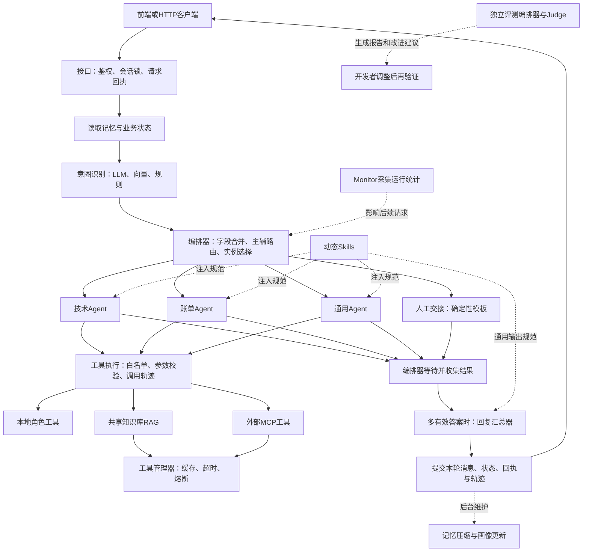

# EchoMind 项目架构、模块输入输出与完整调用演算

本文以当前 Python 后端为完整主线，补充前端、Java 后端和管理流程。按职责划分模块，不表示这些模块分别运行在独立进程中。

计算覆盖项目应用代码中的识别、路由、检索、状态、监控和评测逻辑。示例模型回复、模型自报置信度、向量匹配分和检索数据采用固定演示值；不将它们当作线上实测效果。

配套演算记录：[request-flow-demo.json](assets/analysis/request-flow-demo.json)。本次离线演算使用真实编排器、意图融合、角色工具、RAG 管理器、Skill 匹配和 Composer 代码；模型传输、向量分支和检索底层替换为固定输入，没有请求外部模型，没有测试真实 HTTP、Redis 或 Chroma 服务。

## 1. 总体架构与模块边界



图中表示模块依赖，不表示每次请求都运行所有节点。单角色请求直接使用该角色的答案；低置信度澄清、人工交接、缓存命中和失败回退都有提前结束或旁路。

前端可以选择 Python 或 Java 后端。一次多 Agent 请求在所选后端内完成，不是 Python Agent 与 Java Agent 跨服务合作。

### 1.1 模块输入输出总表

| 编号 | 模块与主要代码 | 输入 | 输出 | 状态归属 |
|---|---|---|---|---|
| M01 | 前端接入、HTTP、身份与会话协调；`api/main.py`、`core/access.py`、`core/concurrency.py` | 用户消息、用户/会话标识、客户端请求编号、可选 Bearer Token | `ChatResponse` 或 HTTP 错误；已确认的用户身份 | 前端设置与请求代次；进程内排队锁；Redis 会话租约和回执 |
| M02 | 记忆与业务字段；`memory/conversation_memory.py`、`core/conversation_state.py` | 用户、会话、查询、近期实体、历史业务状态、最终回复 | `MemoryContext`、合并状态；提交成功或异常 | Redis 近期消息/摘要/状态；Chroma 情景摘要/画像 |
| M03 | 意图识别；`core/intent_recognizer.py`、`core/intent_embedding.py` | 当前消息、近期历史、意图示例 | `IntentResult`：意图、分组、融合分、来源分、实体、紧急度 | 进程内识别缓存、模板向量缓存、在线向量冷却状态 |
| M04 | 编排路由；`AgentOrchestrator` | 完整 `Request`、Agent 池、可用性与统计 | `RoutingDecision`，执行后输出 `OrchestratorResult` | Agent 池、实例统计、近期轨迹；本轮任务和决策 |
| M05 | 角色执行；`BaseAgent` 与三个业务子类、`EscalationAgent` | 同一请求对象、角色配置、匹配的 Skill、工具白名单 | `AgentResponse`：正文、状态、升级标记、工具轨迹 | 每次调用独立的消息列表；实例持有累计统计 |
| M06 | 业务规范；`core/skill_loader.py` | Skill 目录、当前消息、当前角色 | 匹配的提示词正文；加载概况和解析错误 | 内存中的已加载 Skill；文件保存原始规范 |
| M07 | 工具执行与 MCP；`agents/tools.py`、`tooling/tool_manager.py`、`tooling/mcp_client.py` | 工具名、JSON 参数、角色/请求上下文 | 本地结果或 `ToolResult`，再包装为 `tool_result` | 请求级副作用保护；工具缓存、统计、熔断器；MCP 连接 |
| M08 | 文档入库与 RAG；`tooling/knowledge_base.py`、管理器检索链 | 入库文档，或查询与 Top-K | 文档片段与元数据，或排序后的检索结果 | Chroma `knowledge_base`；缓存版本及完整检索缓存 |
| M09 | 回复汇总；`ResponseComposer` | 原始问题、各专业结果、主次顺序、匹配的通用 Skill | 一条合并正文和整体执行状态 | 本次提示词和结果；没有自己的长期记忆或工具循环 |
| M10 | 模型访问；`core/llm_utils.py` 与启动配置 | 模型名、system/messages、工具定义、温度、输出预算 | 模型内容块、终止原因和供应商报告的用量 | 共享客户端；请求级性能记录 |
| M11 | 监控与追踪；`monitor/performance_monitor.py`、`core/performance.py` | Agent/工具统计、调用耗时和用量、请求轨迹 | 惩罚、告警、建议、Prometheus 指标、查询轨迹 | 进程内指标与窗口；Redis 中脱敏轨迹 |
| M12 | 评测与回归；`evaluation/evaluator.py`、`evaluation/jobs.py` | 标注用例、参考答案/核验资料、预期行为、Judge 配置 | 作业状态、分类指标、质量评分、通过率、回归报告 | 进程内作业队列；独立评测状态；报告/基线文件 |

### 1.2 三个必须分清的边界

1. **Agent 与知识库不是一对一。** 技术、账单和通用角色共享业务知识库；当前没有按角色执行领域过滤。它们使用不同查询、提示词和本地工具。
2. **本地角色工具不都经过工具管理器。** `lookup_error_code`、`check_billing_fields` 等由 `BaseAgent` 校验并直接调用 handler；共享 RAG handler 再进入 `MCPToolManager`，外部 MCP 工具也进入该管理器。
3. **控制组件与业务 Agent 不同。** 编排器用代码决策和调度；Composer 负责模型整合；人工交接虽然实现 Agent 接口，但重写处理方法后采用确定性模板。

### 1.3 角色配置与可见工具

| 角色 | 输入关注点 | 输出关注点 | 默认温度/输出上限 | 本地工具，另可共享RAG |
|---|---|---|---|---|
| General | 背景、意图、画像、已知实体 | 回答或澄清，给出下一步 | 0.3 / 900 tokens | inspect_request_context、suggest_required_fields |
| Technical | 错误码、环境、时间、影响范围、最近变更 | 诊断方向、排查步骤、验证办法、缺失信息 | 0.1 / 1200 tokens | lookup_error_code、build_diagnostic_plan |
| Billing | 订单、金额、日期、支付渠道、用户期望 | 待核验字段、可判断事实、处理路径与边界 | 0.0 / 1100 tokens | check_billing_fields、compare_amounts |
| Escalation | 已有意图、紧急度、实体 | 固定模板交接文字和升级标记 | 当前不请求模型 | handle重写后不运行通用工具循环 |

输入关注点不是都已被系统获得；缺少时角色会说明需要补充。输出契约主要体现为提示词要求，专业正文并没有全部转换成强制字段化JSON。

## 2. 核心数据对象与状态所有权

### 2.1 从外部请求到最终结果

```text
ChatRequest
  message / user_id / conv_id / client_request_id
        ↓
MemoryContext + IntentResult
        ↓
Request
        ↓
RoutingDecision
        ↓
多个 AgentResponse
        ↓
AgentCallResult（Composer 的输出）
        ↓
OrchestratorResult
        ↓
ChatResponse
```

| 对象 | 关键字段 | 生产者 → 消费者 |
|---|---|---|
| `ChatRequest` | `message`、`user_id`、`conv_id`、`client_request_id` | 客户端 → API |
| `MemoryContext` | `recent_messages`、`relevant_history`、`user_profile`、`summary`、`state` | MemoryManager → API/业务字段合并 |
| `IntentResult` | `intent`、`intent_group`、`confidence`、`urgency`、`entities`、`source_scores`、`embedding_source` | 识别器 → API/编排器 |
| `Request` | 消息、身份、背景、历史、意图、实体、紧急度、`request_id`、工具尝试/副作用集合、业务状态 | API → 编排器、各专业 Agent 和工具 |
| `RoutingDecision` | `primary_agent`、`supporting_agents`、`reason`、`confidence` | 路由代码 → 执行代码 |
| `AgentResponse` | `agent_type`、`content`、`success`、`confidence`、`status`、`escalate`、`latency_ms`、`tools_used`、`tool_traces`、`error_code` | 专业 Agent → 编排器/Composer |
| `ToolResult` | `success`、`data`、`tool_name`、`error`、`cached`、`latency_ms`、`reranked` | 工具管理器 → RAG/MCP 包装层 |
| `OrchestratorResult` | 最终正文、计划主辅角色、实际角色、工具和轨迹、路由理由/分数、整体状态、是否可重试 | 编排器 → API |
| `ChatResponse` | 对外结果，另含实体、意图来源分、知识使用标记、性能概况 | API → 客户端，并写入回执 |

`user_id` 确定用户，`conv_id` 确定会话，`client_request_id` 标识客户端一次提交，`request_id` 标识服务端本次执行与轨迹。重试复用客户端请求编号，不等于所有重试都复用同一次服务端执行。

未提供客户端请求编号时生成UUID4；未提供会话编号时，API用UUID5和`user_id + ":" + client_request_id`确定本次会话；内部Request默认另生成UUID4作为执行编号。继续已有对话时应明确复用conv_id。

### 2.2 哪些内容共享，哪些内容独立

| 状态 | 范围 | 是否跨请求保留 |
|---|---|---|
| `messages`、本分支 `tools_used/tool_traces` | 某次 Agent 调用 | 不作为该 Agent 的永久对话保存 |
| `Request` 及 `tool_attempts/unsafe_tool_calls` | 同一次复合请求的所有分支 | 请求结束后不作为共享 Agent 实例字段保留 |
| Agent 配置、共享模型客户端、工具定义 | 服务实例 | 保留，供多个请求复用 |
| Agent 成功率、延迟、冷却状态 | Agent 实例 | 当前进程生命周期内保留 |
| 工作记忆、摘要、业务状态 | 用户＋会话 | Redis，相关写入刷新 24h TTL |
| 情景记忆 | 当前会话优先，再补同一用户其他会话 | Chroma 持久化摘要 |
| 用户画像 | 用户 | Chroma，跨该用户的会话共享 |
| 业务知识库 | 应用共享资料 | Chroma，当前无用户/角色领域过滤 |
| 工具缓存与版本、评测作业、监控窗口 | 应用进程 | 不自动在多个应用进程间共享 |

技术和账单 Agent 共享同一个请求对象，但各自的模型消息列表独立。共享 API Key 或模型客户端不会自动合并两者的对话。

## 3. 请求前的启动与资料准备

### 3.1 启动时

1. 加载模型与服务配置；生产鉴权配置不合法时启动失败。
2. 从 Skill 目录加载规范，记录解析失败文件。
3. 创建模型客户端、意图识别器、Composer 和 Agent 池。默认每类角色一个实例。
4. 初始化 Redis 记忆访问和 Chroma 集合。
5. 注册 `knowledge_search`，再将 `search_knowledge_base` 作为共享 Agent 工具分发。
6. 按配置连接外部 MCP 服务，发现允许的工具并限制可用角色。
7. 建立独立的评测编排器与工具管理状态。
8. 启动后台记忆维护和监控采集。

Python 三个业务角色默认共用全局模型服务地址、凭据和模型，模型名可由 `ECHOMIND_GENERAL_MODEL`、`ECHOMIND_TECHNICAL_MODEL`、`ECHOMIND_BILLING_MODEL` 分别覆盖。角色差异来自提示词、Skill、工具和生成参数。

### 3.2 文档如何进入业务知识库

```text
/knowledge/add 或 /knowledge/upload
→ 校验 title/content/document_id
→ 按文档身份合并本批重复项，采用最后一份
→ 切分片段
→ 计算文档身份与内容版本
→ Chroma向量化并upsert
→ 清除该文档多余的旧片段
→ 提高线上及评测检索缓存版本，清除旧缓存
```

Python 默认切分以 500 字符为上限：先按中文句号和换行拆句，再拼接，超长单句再切片；相邻片段没有重叠。这里是字符，不是 token。

文档身份是带类型标记的显式编号或标题的 SHA-256；内容版本是正文的 SHA-256；片段编号形如 `document_id:片段序号`。元数据保存标题、身份、版本、片段序号和总片段数。

默认六篇演示资料为退款政策、订单查询、账户安全、技术故障排查、会员与积分、配送说明。仅在非生产、空库且开启演示导入时自动加入。源码、wiki、Skill 不会因存在于目录中就自动成为 RAG 内容。

## 4. 一次完整复合请求：逐步输入、计算与输出

### 4.1 演算前提

```json
{
  "message": "登录时报 401，同时这笔订单被重复扣款 99 元。",
  "user_id": "demo-user",
  "conv_id": "demo-conversation",
  "client_request_id": "turn-001"
}
```

假设无历史、无缓存、专业角色可用。模型和向量分支的演示输入分别是 `technical_login/0.92`、`technical_login/0.85`。为覆盖 RAG 路径，固定技术模型本次决定检索知识库；真实运行由模型按需决定。

### 步骤 1：接口接收与幂等检查

**输入：** ChatRequest、可选鉴权身份。

**处理：** 鉴权开启时以服务端身份为准；获得用户＋会话的锁；设置整轮 50 秒超时；按客户端请求编号查询回执。

**分支：** 同编号换消息返回 409；已有成功结果或不可重试失败结果直接返回；可重试失败允许重新执行。

**本例输出：** 没有回执，进入本次执行，获得新的服务端 `request_id`，此处用 `demo-request` 示意。

前端聊天请求超时默认 55 秒，后端整轮预算 50 秒；这些都是上限，不能把各阶段单独超时相加当成整轮预算。

### 步骤 2：读取记忆

**输入：** 用户、会话、当前消息。

**处理：** 近期原文最多读 20 条；情景检索先限定用户＋会话，少于 5 条时再按用户补充；读取画像、摘要、业务状态。

**输出：** MemoryContext。本例为空。

格式化背景默认包含最多 3 条相关历史、用户画像、会话摘要和最近 8 条原文。接口给识别器最近最多 5 条历史，LLM 分类分支实际取最后 3 条。

### 步骤 3：意图缓存与三路识别

**输入：** 当前消息＋近期历史。

缓存键包含当前问题和最近 3 条历史的角色、正文。相同问题但历史变化，不保证命中同一意图缓存。

未命中时，Python 并行执行 LLM 和向量分支，同步执行 Pattern 分支。

| 来源 | 本例类别 | 原始分 | 权重 | 加权贡献 |
|---|---|---:|---:|---:|
| LLM，演示输入 | technical_login | 0.92 | 0.70 | 0.644 |
| 向量，演示输入 | technical_login | 0.85 | 0.20 | 0.170 |
| Pattern，代码实际计算 | payment_issue | 0.50 | 0.10 | 0.050 |

Pattern 对每类统计命中的关键词种类，公式为 `min(1, 0.5 + 0.25 × (hits - 1))`。本句“重复扣款”和“401”分别使支付异常、登录异常各得 0.5；当前遍历顺序在同分时保留支付异常类别。

向量分支对每类模板取最大余弦相似度，再选择最佳类别：

```text
cos(q, t) = dot(q,t) / (norm(q) × norm(t))
类别向量分 = 该类所有模板相似度的最大值
```

正常融合先累计大类，再在最佳大类中选细类：

```text
技术大类 = 0.92×0.70 + 0.85×0.20 = 0.814
账单大类 = 0.50×0.10 = 0.050
```

**输出：** `intent=technical_login`，`intent_group=technical`，`confidence=0.814`。本例最佳细类已经明确，不走通用意图细化分支。

正常融合低于 0.5 返回 OTHER；关闭向量分支时 Python 权重改为 0.85/0.15。LLM 失败有单独的“有效向量优先，其次规则”回退路径，不能把正常阈值流程套到所有失败分支。

通用意图细化的条件是：当前最佳标签属于泛类，Pattern给出细类，二者属于同一大类，Pattern分≥0.5，且最佳大类融合分<0.8。满足时采用Pattern细类，输出分取两者最大值。

在线意图向量可使用BGE-M3；失败后问题和模板一起回退本地。Python本地向量为256维：对去重的1/2/3字符n-gram计算MD5，用摘要前4字节对256取模定位桶，用第5字节奇偶确定±1并累计，最后用余弦公式匹配。这是稳定的哈希近似，不是额外训练的神经向量模型。

正常意图缓存默认300秒；配置了在线向量但结果降级为本地时缓存60秒。缓存达到1000项时清除较早插入的500项，当前并不在每次命中时更新严格LRU顺序。

### 步骤 4：实体、紧急度和业务状态合并

**实体输出：**

```json
{
  "order_id": [],
  "product": [],
  "date": [],
  "amount": ["99 元"],
  "error_code": ["401"]
}
```

金额、日期、订单号、错误码由正则提取，不是再次请求模型。仅出现“订单”一词，不等于获得了订单号。

紧急度先按关键词判断，并处理部分否定表达；本例没有紧急词，意图也不是投诉或转人工，因此为 LOW。当前规则中“紧急/立刻”等可得到 CRITICAL，“今天/马上/尽快”等可得到 HIGH。

**合并输入：** 旧业务状态、当前实体、意图分组、消息、请求编号。

**合并规则：** billing/query 映射到 commerce；同任务可继承旧字段。更换订单、明确新任务、切换不兼容业务领域时，不继续继承旧字段。记录字段来源请求编号。字段齐全不等于身份或订单已被真实系统核验。

**本例合并输出：**

```json
{
  "domain": "technical",
  "entities": {
    "order_id": [], "product": [], "date": [],
    "amount": ["99 元"], "error_code": ["401"]
  },
  "sources": {"amount": "demo-request", "error_code": "demo-request"}
}
```

### 步骤 5：前置澄清与优先路由

`run()` 先检查低置信度 OTHER 且消息长度超过 2 的澄清条件；通过后才进入 `_route_decision()`。

路由内部先检查 CRITICAL，再检查 escalation/human_handoff；这些通常直接选择人工交接节点。本例为 technical_login＋LOW，继续计算普通角色领域分。

### 步骤 6：领域评分，选择主角色

| 角色 | 基础分 | 意图分 | 关键词分 | 实体分 | 本例总分 |
|---|---:|---:|---:|---:|---:|
| general | 0.10 | 0 | 订单：0.12 | 无订单号：0 | **0.22** |
| technical | 0 | technical_login：0.75 | 401：0.18 | 错误码：0.20 | **1.13** |
| billing | 0 | 0 | 扣款：0.18 | 金额：0.15 | **0.33** |

领域分完整规则：

- general 的意图加分 0.55：query、order_status、logistics、request、complaint、greeting、feedback、other。
- technical 的意图加分 0.75：technical、technical_login、technical_crash。
- billing 的意图加分 0.75：billing、account、account_security、refund、invoice、payment_issue。
- 技术关键词：崩溃、报错、error、crash、无法登录、登录失败、500、401、验证码；`min(0.45, hits×0.18)`。
- 账单关键词：退款、退货、扣款、发票、账单、支付、订阅、refund、invoice、多扣；`min(0.45, hits×0.18)`。
- 通用关键词：订单、物流、快递、配送、会员、积分、咨询、帮助；`min(0.35, hits×0.12)`。
- 非空 error_code 给技术加 0.20，非空 amount 给账单加 0.15，非空 order_id 给通用加 0.10；每种实体最多加一次，不随金额或实体数量增加。

关键词忽略大小写，按字符串包含统计列表命中种类，不按重复出现次数计数。意图加分不再乘 0.814 置信度。

排除当前不可用的专业角色后，最高分为主角色。**本例输出：technical。**

`routing_confidence = round(min(primary_score, 1), 3)`，所以得到 **1.0**。这是截断的规则分，不能解释为正确概率。

### 步骤 7：选择辅助角色

协作检测的技术关键词为崩溃、报错、error、crash、无法登录、登录失败、500、401；账单关键词为退款、扣款、发票、账单、支付、订阅、refund、invoice，并结合对应意图类别。

这份列表与领域评分关键词列表并不完全相同。

```text
技术意图或401 → technical
扣款         → billing
去掉主角色和不可用角色 → supporting_agents=[billing]
```

只有未直接选出辅助角色时，才补选满足 `score≥0.45` 且 `score≥primary_score×0.55` 的其他专业角色。本例账单 0.33 不满足评分补选，但明确协作信号已经使其参与。

**输出：** 主技术、辅账单，`multi_agent=True`。

### 步骤 8：选择具体实例

默认每类只有一个实例；同类多个实例时，从可用实例选择最高运行评分：

```text
成功率 s = 累计成功数 / 累计调用数（无调用时为1）
平均耗时 t = 累计耗时 / 累计调用数（无调用时为0）
延迟分 = 1 / (1 + t/1000)
运行评分 = (0.7×s + 0.3×延迟分) × max(0, 1-惩罚)
```

用于说明多实例选择的独立例子：

| 实例 | 调用/成功 | 平均耗时 | 惩罚 | 运行评分 |
|---|---|---:|---:|---:|
| technical-A | 100/95 | 2000ms | 0.1 | `(0.665+0.1)×0.9=0.6885` |
| technical-B | 100/90 | 5000ms | 0 | `0.63+0.05=0.6800` |

A 得分更高。这两个实例只是扩展场景演算，未添加到实际默认 Agent 池。

### 步骤 9：并行派发与 Skill 注入

```python
tasks = [self._execute(req, role) for role in decision.agent_types]
responses = await asyncio.gather(*tasks, return_exceptions=True)
```

主 Agent 不负责启动辅助 Agent；两者都由编排器启动。传入的是同一个 Request，但每次 Agent 调用各自创建 messages、tools_used、tool_traces。

本例 Skill 匹配结果：技术角色因 401 命中技术规范；账单角色因扣款命中账单规范。Composer 后续按 general 匹配，因订单命中通用规范。

匹配条件为 enabled＋适用角色＋任一关键词；没有关键词则在适用角色范围内默认匹配。不是由模型主动打开 Skill 文件。Python 默认每次 Skill 正文预算 5000 字符，单个正文块也受长度限制。

### 步骤 10：两个专业分支各自执行模型与工具循环

技术模型第一轮的固定演示输出：

```text
tool_use id=technical_tool_1
  lookup_error_code({"error_code":"401"})
tool_use id=technical_tool_2
  search_knowledge_base({"query":"登录401认证失败排查","top_k":2})
```

执行代码先检查工具白名单、JSON Schema 和副作用限制，再运行 handler。401 工具直接返回认证失败方向、Token/签名/登录状态排查步骤以及 `server_log_checked=False`。

账单模型第一轮输出：

```text
tool_use id=billing_tool_1
  check_billing_fields({})
```

本例检查结果为 order_id=False、amount=True、date=False、payment_channel=False；缺订单号、时间、支付渠道，`can_confirm_refund=False`。它没有读取支付系统。

同一个模型回复中若有多个工具请求，当前 BaseAgent 按顺序执行这些工具；不同 Agent 的分支仍可以交错推进。并行不意味着每个内部操作都并行。

结果作为 `tool_result` 回传，使用 `tool_use_id` 对应原调用。技术、账单模型随后各进行第二轮调用，生成最终专业正文。

每个专业 Agent 最多进行 3 轮模型调用；一轮可有多个工具调用。15 秒默认限制的是单次角色模型调用，不是整个含工具的 Agent 处理时长。

### 步骤 11：技术分支内部的 RAG 全链路

**输入：** query=登录401认证失败排查，top_k=2。

1. 检查完整流程缓存；本次未命中，记录缓存版本。
2. 一次 `rag.rewrite` 模型调用生成最多 3 个改写，加上原查询去重，本例共 4 个查询。
3. `recall_k=max(top_k,5)=5`，4 个查询并行调用知识检索。
4. 每个底层工具调用依次经过参数校验、缓存、熔断检查、带超时的 handler、统计与缓存写入。
5. 正常知识库由 Chroma 生成查询向量并返回距离。Python 展示分数计算为 `round(1-distance,4)`；它不是答案正确概率。
6. 按文档身份、标题、内容和片段编号构造 SHA-256 去重键。分数不进入去重身份，避免同一片段因不同查询分数而重复。
7. 合并候选超过 2 条，调用 LLM rerank；否则直接返回，不重排。
8. 返回 Top-2 片段以及 success/cached/reranked 标记，再由技术模型使用。

演示查询共四条，模拟底层每条返回相同的三个候选，所以 12 条原始结果合并成 3 条：

| 候选 | 演示距离 | Python转换分 | 演示资料 |
|---|---:|---:|---|
| D0 | 0.22 | 0.78 | 技术故障排查 |
| D1 | 0.40 | 0.60 | 账户安全 |
| D2 | 0.65 | 0.35 | 订单查询 |

演示重排返回 `[0,1,2]`，最终保留 D0、D1。实际重排模型只接收每条序列化结果前 200 字符，返回排序索引；程序校验索引、去重并补齐遗漏项，再截 Top-K。没有专用 Cross Encoder，也没有输出一个用于路由的“重排置信度”。

完整缓存默认沿用知识工具 300 秒 TTL。缓存键包含查询、Top-K、工具版本、传入 context 等；当前共享知识库 handler 没有自动传入用户画像/领域过滤 context。外部 MCP handler 会传用户标识作为其缓存 context。

本次离线演算随后重复同一 RAG 查询，命中完整缓存，额外模型调用为 0、底层召回次数保持 4。这个检查不是客户端请求回执重放，也不是证明后续真实多轮对话一定命中意图缓存。

### 步骤 12：专业结果返回，编排器收集

**输入：** 两个分支的执行完成事件。

**输出：** 两个 AgentResponse，分别含最终正文、角色、success/status、升级建议、工具名称及轨迹。

结果顺序保持任务传入顺序，不按完成先后排序。每个角色的工具轨迹保持独立，编排器合并时再拼接和去重工具名称。

Agent 间通信的准确描述：

| 方向 | 内容 | 通道 |
|---|---|---|
| 编排器→专业角色 | Request | 进程内函数调用 |
| 模型→工具运行代码 | 工具名、参数、调用ID | tool_use 内容块 |
| 工具运行代码→模型 | 工具数据或错误 | tool_result＋对应ID |
| 专业角色→编排器 | AgentResponse | await 返回值 |
| 编排器→Composer | 原请求与结果列表 | 进程内函数调用 |

技术和账单之间没有直接的专业答案消息、讨论轮次或消息队列；没有一方读完另一方中间结论再重新规划。共享请求级保护状态不等于共享同一份模型对话。

### 步骤 13：Composer 汇总

先筛选 success=True 且正文非空的结果：无有效答案返回失败；只有一份直接采用；多份才请求模型汇总。

汇总提示词使用原始问题、各专业正文与角色标签、主处理信息及匹配的通用 Skill。不会把原始 Agent 对话、全部工具轨迹、完整历史、全部 RAG 片段直接发送给汇总模型，也没有创建压缩文档。

要求模型以主处理为主、按优先级组织、去重、冲突时说明需核验、保留必要步骤和边界、不编造后台结果。Python 取第一个有效结果作为主处理；正常主分支成功时就是计划主角色。

默认 Composer 温度 0.1、最大输出 1000 tokens、超时 8 秒。失败或无正文时拼成“主答案＋补充说明”，不额外把完整对话做记忆压缩。

领域分、实例运行评分和 AgentResponse.confidence 不参与正文的数学加权投票。AgentResponse.confidence 默认 1.0 也不是此次答案的事实准确率。

### 步骤 14：封装结果、提交记忆、返回

本例固定账单正文包含“人工客服”，所以分支升级关键词检测得到 escalate=True。并行结果的 escalated 是各分支标记的 any，不是工单创建成功。

```json
{
  "request_id": "demo-request",
  "conv_id": "demo-conversation",
  "intent": "technical_login",
  "intent_group": "technical",
  "intent_confidence": 0.814,
  "intent_source_scores": {"llm":0.92,"embedding":0.85,"pattern":0.5},
  "primary_agent": "technical",
  "supporting_agents": ["billing"],
  "agent_types": ["technical","billing"],
  "routing_confidence": 1.0,
  "tools_used": ["lookup_error_code","search_knowledge_base","check_billing_fields"],
  "knowledge_used": true,
  "status": "success",
  "retryable": false,
  "escalated": true,
  "error_code": null
}
```

另有实际最终正文、路由理由、实体、来源标记、总耗时和性能概况。`knowledge_used=True` 表示轨迹中至少有一次该知识工具返回 success，不证明每句话均有出处。`success` 表示执行完成，不表示确认重复扣款或已退款。

API 用 Redis 事务保存用户消息＋一份最终助手回复、业务状态、客户端回执、脱敏轨迹。专业角色中间正文不分别作为正式助手消息追加。失败结果保存回执，但不作为正常消息和业务状态提交。

本例正常会话新增两条消息。之后提交后台维护任务；不足 15 条不压缩。后台画像更新可能额外请求模型，不计入下面已完成的编排器演算调用数。

### 4.2 本例实际离线执行数量

| 阶段 | 模型调用数 |
|---|---:|
| 意图LLM | 1 |
| 技术Agent | 2 |
| 账单Agent | 2 |
| RAG查询改写 | 1 |
| RAG重排 | 1 |
| Composer | 1 |
| 合计 | **8** |

另有 **4 次模拟向量召回**、3 个角色可见工具轨迹，以及固定输入的意图向量分支。初次在线模板向量请求、实际 Chroma 向量化、后台画像/摘要和客户端重试都不包含在此离线计数中。

如果两专业分支耗时分别为 T技术、T账单，等待阶段接近 `max(T技术,T账单)`，随后再加 Composer；完整 HTTP 耗时还包括排队、记忆、意图和提交。并行不会让两分支调用量相互抵消。

`performance.llm.latency_ms`累加各次模型调用的耗时；它不是HTTP墙钟耗时，并行时两者不能直接等同。调用数是公共SDK包装层记录的逻辑调用数，供应商未报告的token用量不应当作已经测得的零消耗；SDK内部重试也不在这里独立计数。

## 5. 所有主要分数的用途对照

| 计算量 | 输入与算法 | 本例或默认值 | 用来做什么 |
|---|---|---|---|
| LLM分支置信度 | 模型输出并经过数字范围检查 | 演示0.92 | 参与意图融合 |
| 向量分支分数 | 各类模板最大余弦相似度 | 演示0.85 | 参与意图融合 |
| Pattern分 | `min(1,0.5+0.25×(hits-1))` | 实际0.5 | 参与意图融合/回退/细化 |
| 意图融合分 | 按来源权重累计大类，选细类 | 0.814 | 确定主意图及是否澄清 |
| 领域分 | 固定意图、关键词、实体与基础权重相加 | 1.13/0.33/0.22 | 选择主辅角色 |
| 路由结果confidence | `min(主领域分,1)` | 1.0 | 暴露规则决策强度 |
| 实例运行分 | 成功率、延迟分、monitor_penalty | 扩展示例0.6885 | 同角色选实例 |
| Chroma展示分 | `round(1-distance,4)` | 演示0.78 | 展示检索结果强度 |
| LLM重排 | 生成并校验排序索引 | 演示[0,1,2] | 选最终资料顺序 |
| 工具轨迹success | handler是否正常完成 | 布尔值 | 调用是否出错 |
| 工具轨迹result_success | 工具结果有success字段时读取 | True/False/None | 结果自身是否报告失败 |
| AgentResponse.confidence | 当前默认字段，不由正文事实核验得来 | 默认1.0 | 当前没有用于答案投票 |
| Monitor惩罚 | 近期成功率和延迟规则 | 0到0.9 | 后续降权、冷却与探测 |
| 异常Z-score | `abs(value-mean)/sample_stdev` | 阈值2.5 | 监控异常记录 |
| 分类Accuracy、P/R/F1 | 预测标签与gold label对比 | 离线计算 | 评测意图识别 |
| Judge总体分 | 相关性/准确性/完整性/有用性算术平均 | 通过阈值0.75 | 评测回复质量 |
| 回归delta | `(当前-基线)/基线` | 小于-0.05标记回归 | 同口径版本比较 |

这些量属于不同阶段，不能相加成一个“项目准确率”。普通 Python 聊天不会自动执行离线 Judge 评分。

## 6. 后台和管理流程

### 6.1 记忆压缩与用户画像

非失败回复提交后，后台队列执行维护。达到 15 条消息才压缩：完整快照→较早消息生成摘要→与旧摘要合并至最多 800 字符→WATCH/MULTI检查快照→裁剪旧消息、保留最近5条及并发新增内容→保存本批情景摘要。

摘要为空、截断或模型失败时保留原消息。工作记忆读取最多20条不等于Redis列表绝对不会超过20条；维护滞后时可以暂时更长。

画像更新读取近期消息和已有画像，请模型生成偏好和实体，再按用户更新。默认维护更新间隔60秒；用户明确要求记住偏好时可绕过该节流检查。

Redis消息、摘要、业务状态和回执相关TTL为24小时；情景摘要和画像没有沿用这个自动过期策略。因此控制上下文长度不等于长期存储已具有总容量回收机制。

### 6.2 监控、降权和异常检测

默认约每10秒采集一次；降权使用最近300秒、最多50个已完成调用，至少5个样本才参与计算：

```text
p = 0
若近期成功率s<0.9：p += min(0.5, (0.9-s)×2)
若近期平均耗时t>3000：p += min(0.4, (t-3000)/10000)
p = min(p,0.9)
```

例如 s=0.65、t=5000ms，p=0.5+0.2=0.7；达到默认0.5回退阈值时专业实例进入默认60秒冷却。冷却后仅一个请求承担恢复探测，成功清除惩罚和探测状态，失败重新冷却。

降权使用近期窗口；Python运行评分中的累计成功率和平均耗时与近期窗口并不是同一组统计。

工具统计的成功率为success/total，平均耗时为total_latency_ms/total。当前工具缓存命中会增加total/success但不增加远端执行耗时，因此该平均值不能直接当作“未命中时的远端调用平均耗时”。

另有滑动Z-score检测：默认窗口60个监控数据点，至少30个才检测；均值和样本标准差包含本次加入的数据点；标准差为0不判异常。z>2.5记录异常，z>3.75标高严重度。它不是另一个答案质量打分模型。

工具熔断器独立于Agent降权：默认连续失败5次打开，60秒后单请求探测。generation避免旧请求迟到结果污染新恢复状态。参数校验失败不应使工具依赖被熔断。

### 6.3 离线评测与回归

`POST /eval/run` 默认返回202和job_id；作业在进程内排队，未完成容量8、单执行worker、单作业执行超时1800秒、保留最近约50个作业。作业可为queued/running/completed/failed/cancelled；服务重启后这些内存状态丢失。

评测构建独立编排器、统计、缓存和熔断状态；真实知识库与外部依赖仍共享。评测Agent仅获得可安全重试的工具。评测不是把参考答案交给被测Agent：参考答案和核验资料供Judge使用。

分类指标：

```text
Accuracy = 正确预测数 / 样本数
Precision = TP/(TP+FP)
Recall = TP/(TP+FN)
F1 = 2PR/(P+R)
Macro-F1 = 本次真实标签与预测标签并集内各类F1的平均值
```

零分母按代码处理为0。定义19种意图不保证某次评测样本覆盖全部19种。

对话通过条件：`agent_status=success`、配置的预期角色/意图/工具/实体检查全部通过、Judge四维平均分≥0.75。Judge解析失败有单独标记，不当作正常质量分；报告可能为partial或failed。

仅相同suite_id、完整、无已标记回归的有效基线参与比较。suite_id包含用例、Judge模型/服务/预算/提示词、Few-shot内容版本和阈值。`delta=(current-baseline)/baseline`，基线>0且delta<-0.05才标记回归。例如0.80降至0.75为相对下降6.25%。

此评测的scope主要为orchestrator，不自动验证HTTP鉴权、真实Redis生命周期、分布式租约和回执写入。那些由接口/存储测试验证。

## 7. 异常分支与状态语义

| 条件 | 当前路径或结果 |
|---|---|
| 模糊OTHER且置信度<0.5、消息长度>2 | 确定性追问，不运行普通专业Agent |
| 进入路由后CRITICAL或明确转人工 | 人工交接节点；确定性格式化意图、优先级和实体，未创建真实工单 |
| 专业实例不可用或处理失败 | 符合条件时由General兜底，保留两次尝试及回退事件 |
| 已尝试不安全工具后失败 | 限制兜底与自动重试；API预先持久化结果待核验回执 |
| 工具异常、结果报告失败 | 作为is_error的tool_result回传，模型可解释失败或尝试其他允许工具 |
| Agent正文到输出上限 | status=partial，不作为完整生成成功统计 |
| 一个专业分支最终失败，另一个可用 | Composer保留可用答案，通常整体partial |
| 所有专业分支最终失败 | 整体failed，Python接口503 |
| Composer失败或空输出 | 按已有专业答案确定性拼接；整体状态沿用专业结果判断 |
| 整轮超过50秒 | HTTP 504；应复用client_request_id核验或重试 |
| 已失去Redis会话租约 | 取消本地持有任务，停止按旧锁状态继续写入 |
| RAG改写失败 | 使用原查询 |
| RAG重排失败 | Python保留合并候选原顺序截Top-K，reranked=False |

以下语义尤其需要注意：

- Python即使某次工具出错，只要模型随后生成完整解释，Agent仍可能success/status=success；应同时查看tool_traces，不能只看顶层状态。Java会把部分工具失败纳入partial判断。
- 计划的primary/supporting与回退后的实际agent_types可能不同，应结合轨迹检查。
- 只要尝试过可能修改外部数据的工具，超时不能证明业务动作未执行。当前没有跨进程崩溃的“业务恰好执行一次”保证。
- 知识使用标记、升级标记、调用成功都不等于事实核验通过、工单提交或退款成功。
- 对多个专业答案的去重和冲突表达主要依靠Composer提示词，不是独立的原始证据核验算法。

## 8. Python 与 Java 的对应关系

| 方面 | Python主线 | Java当前实现 |
|---|---|---|
| Web接口 | FastAPI | Spring Boot |
| 模型调用 | AsyncAnthropic＋create_message | LangChain4j ChatModel/AiServices |
| 意图分支执行 | LLM和向量分支并行 | 当前依次调用LLM、向量，再融合 |
| 专业角色并行 | asyncio.gather | 虚拟线程执行器＋Future |
| 工具循环 | BaseAgent中显式处理tool_use/tool_result，最多3轮模型调用 | AiServices与RegistryToolProvider，最多4次顺序工具调用配置 |
| 分段 | 500字符、句号换行规则、无重叠 | 自定义TextChunker，500字符、80重叠、优先标点 |
| 业务检索 | Chroma向量召回 | BM25与向量分归一化后加权，默认0.45/0.55 |
| 向量来源 | Chroma默认本地MiniLM；意图在线BGE分支独立 | 默认MiniLM语义存储，可本地持久化或Chroma；允许的场景下可回退hash向量 |
| 重排 | 聊天LLM生成排序索引 | 聊天LLM生成排序索引；两者都没有专用Cross Encoder |
| 长期记忆 | Chroma情景摘要和画像 | 依语义存储模式本地持久化向量库/Chroma，另有JSON回退实现 |
| 汇总后校验 | 当前在线聊天没有独立Verifier步骤 | AnswerVerifier结合背景、历史、成功工具证据校验，失败时降级 |
| 输入预算 | 多处字符/消息/轮数上限 | 另有PromptBudget，按UTF-8字节做保守估计，限制背景、工具和总输入 |

Java的BM25公式使用k1=1.5、b=0.75：`idf=ln(1+(N-df+0.5)/(df+0.5))`，每个查询词贡献为`idf×tf×2.5/[tf+1.5×(1-0.75+0.75×dl/avgdl)]`。两种检索分各按自身最大值归一化，再加权；不是RRF融合。

Java输入预算估算不等于供应商实际token计数。输入预算、输出max_tokens、消息压缩阈值和知识分段字符数是不同限制。

## 9. 源码导航与验证范围

| 内容 | 源码位置 |
|---|---|
| API入口和回执 | [api/main.py](../api/main.py) |
| 身份鉴权 | [core/access.py](../core/access.py) |
| 会话锁与后台队列 | [core/concurrency.py](../core/concurrency.py) |
| 记忆读写、压缩、画像 | [memory/conversation_memory.py](../memory/conversation_memory.py) |
| 业务字段合并 | [core/conversation_state.py](../core/conversation_state.py) |
| 意图识别与融合 | [core/intent_recognizer.py](../core/intent_recognizer.py) |
| 在线向量与回退 | [core/intent_embedding.py](../core/intent_embedding.py) |
| Agent、路由、汇总 | [agents/agent_orchestrator.py](../agents/agent_orchestrator.py) |
| 本地角色工具与RAG包装 | [agents/tools.py](../agents/tools.py) |
| Skill加载与匹配 | [core/skill_loader.py](../core/skill_loader.py) |
| 工具治理、查询改写、重排 | [tooling/tool_manager.py](../tooling/tool_manager.py) |
| 文档切分和Chroma查询 | [tooling/knowledge_base.py](../tooling/knowledge_base.py) |
| MCP客户端与服务端 | [mcp_client.py](../tooling/mcp_client.py)、[mcp_server.py](../tooling/mcp_server.py) |
| 模型公共访问与性能 | [llm_utils.py](../core/llm_utils.py)、[performance.py](../core/performance.py) |
| 监控与恢复 | [monitor/performance_monitor.py](../monitor/performance_monitor.py) |
| 评测与作业 | [evaluator.py](../evaluation/evaluator.py)、[jobs.py](../evaluation/jobs.py) |

离线演算已检查：Pattern类别、0.814融合分、三角色领域分、主辅选择、业务字段合并、三个Skill匹配、三个工具轨迹、RAG四路调用与去重/重排、8次模拟模型调用、整体成功/升级标记、相同RAG查询命中缓存不再增加模型调用。

这不是线上模型质量评测、HTTP集成测试或真实Redis/Chroma压测。模型自报分、演示检索距离、模拟资料和示例耗时不应作为简历效果指标。
